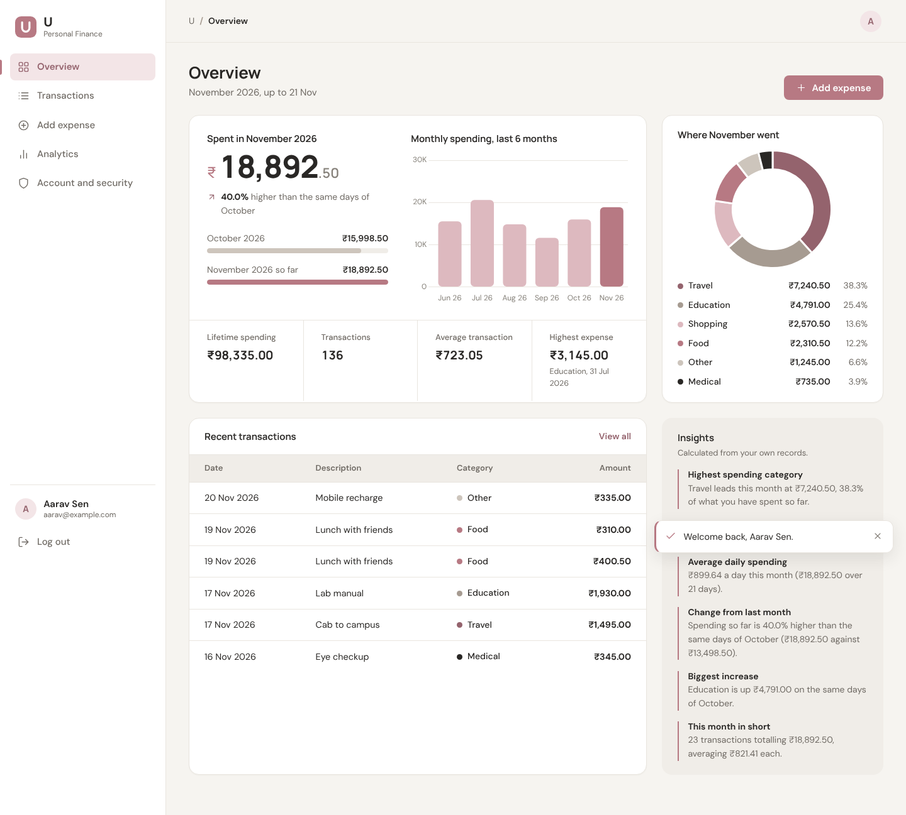
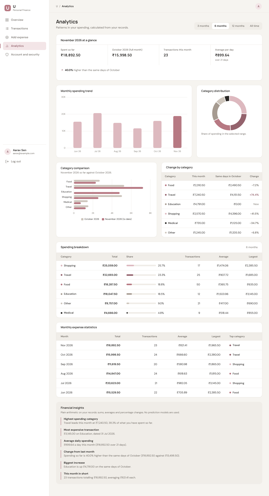
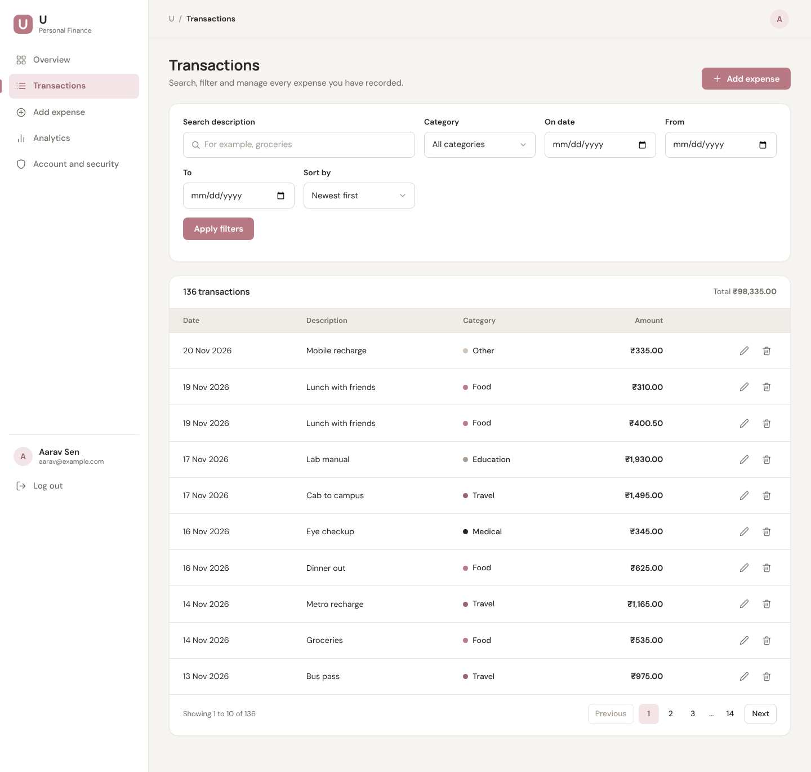
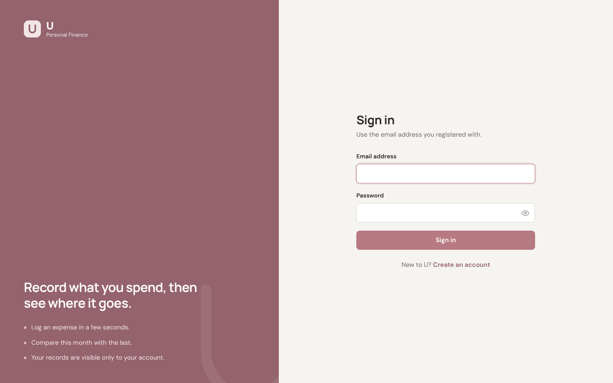

# U — Secure Daily Expense Tracker

**Personal Finance & Expense Intelligence** · final-year B.Tech (Computer Science) capstone project

U is a private, multi-user expense tracker built with Flask and SQLite. Users record daily expenses, browse and filter them, and read charts and plain-language insights calculated from their own records. The interface follows a strict warm-ivory / dusty-rose / taupe / charcoal design system, and security (hashing, CSRF, rate limiting, ownership checks, CSP) is part of the design rather than an add-on.

> Everything in this README was produced and checked in the project environment. Sections marked **Verified** say what was actually run; the [Limitations](#limitations) section lists what was not.

---

## Features

| Module | What it does |
|---|---|
| **Authentication** | Registration, login, logout, e-mail validation, password confirmation, duplicate-e-mail prevention, salted password hashing, session management, failed-login recording, per-IP rate limiting, per-e-mail lock-out, protected routes, profile edit, password change |
| **Overview dashboard** | Month-to-date spending, previous month, lifetime total, transaction count, average and highest expense, recent transactions, category mix, 6-month trend, current vs previous month |
| **Expenses** | Add / view / edit / delete; six categories (Food, Travel, Education, Shopping, Medical, Other); validation, delete-confirmation modal, toast feedback |
| **Transactions** | Search descriptions, filter by category / exact date / date range, sort by date or amount, pagination, live count and total, clear filters |
| **Analytics** | Monthly trend, category distribution, current-vs-previous category comparison, spending breakdown table, monthly statistics (Chart.js) |
| **Insights** | Highest category, most expensive transaction, average daily spending, change from last month, biggest category increase, monthly summary — plain arithmetic, **no AI/ML claims** |
| **Account & security centre** | Profile, member-since date, password change, security information, recent sign-in activity, log out |

## Technology stack

* **Backend:** Python, Flask, Flask-SQLAlchemy, Flask-Login, Werkzeug
* **Frontend:** HTML5, CSS3, Bootstrap 5.3 (layout, modal, dropdown, toast, offcanvas), JavaScript ES6+, Chart.js 4
* **Database:** SQLite
* **Security:** Flask-WTF (CSRF + validation), Flask-Limiter, Werkzeug password hashing
* **Testing:** Pytest + Flask test client
* **Fonts:** Manrope (headings), DM Sans (body) — self-hosted

Bootstrap, Chart.js and the fonts are **vendored in `app/static/`** so the app works offline and the Content-Security-Policy can be strict (`script-src 'self'`, no inline scripts or styles).

## Architecture

Layered Flask application using Blueprints (diagram: `docs/diagrams/architecture.png`):

```
Browser ──► security middleware (headers/CSP, CSRF, rate limiter, sessions)
        ──► Blueprints + WTForms     (auth, main, expenses, analytics, account)
        ──► Services                 (auth_service, expense_service, analytics_service)
        ──► SQLAlchemy models        (User, Expense, LoginAttempt)
        ──► SQLite
```

Business rules (ownership checks, filtering, every financial calculation) live in `app/services/`, not in route handlers.

### Database

| Table | Columns |
|---|---|
| `users` | id, username, email (unique, indexed), password_hash, created_at |
| `expenses` | id, user_id (FK → users, `ON DELETE CASCADE`), category, amount, expense_date, description, created_at, updated_at |
| `login_attempts` | id, email, attempted_at, success |

* `users 1 ── N expenses`; each expense belongs to exactly one user and every query is scoped by `user_id`.
* `login_attempts` is linked to users **by e-mail only (no foreign key)** on purpose: attempts against unknown addresses are recorded too.
* Constraints: `amount > 0`, `category IN (...)`, unique e-mail, foreign keys (SQLite `PRAGMA foreign_keys=ON` is enabled on every connection).
* Indexes: `users.email`, `expenses(user_id, expense_date)`, `expenses(user_id, category)`, `login_attempts(email, attempted_at)`.
* **Money is stored as integer paise** (custom `Money` column type) so arithmetic is exact: `0.10 + 0.20 == 0.30`.

Full ER diagram: `docs/diagrams/er_diagram.png`.

## Project structure

```
U-Secure-Daily-Expense-Tracker/
├── app/
│   ├── blueprints/
│   │   ├── account/
│   │   │   ├── __init__.py
│   │   │   └── routes.py
│   │   ├── analytics/
│   │   │   ├── __init__.py
│   │   │   └── routes.py
│   │   ├── auth/
│   │   │   ├── __init__.py
│   │   │   └── routes.py
│   │   ├── expenses/
│   │   │   ├── __init__.py
│   │   │   └── routes.py
│   │   ├── main/
│   │   │   ├── __init__.py
│   │   │   └── routes.py
│   │   └── __init__.py
│   ├── services/
│   │   ├── __init__.py
│   │   ├── analytics_service.py
│   │   ├── auth_service.py
│   │   └── expense_service.py
│   ├── static/
│   │   ├── css/
│   │   │   ├── fonts.css
│   │   │   └── u.css
│   │   ├── img/
│   │   └── js/
│   │       ├── charts.js
│   │       └── u.js
│   ├── templates/
│   │   ├── account/
│   │   │   └── index.html
│   │   ├── auth/
│   │   │   ├── login.html
│   │   │   └── register.html
│   │   ├── errors/
│   │   │   └── error.html
│   │   ├── expenses/
│   │   │   ├── form.html
│   │   │   └── index.html
│   │   ├── partials/
│   │   │   ├── _delete_modal.html
│   │   │   ├── _forms.html
│   │   │   ├── _icons.html
│   │   │   └── _ui.html
│   │   ├── analytics.html
│   │   ├── app_base.html
│   │   ├── auth_base.html
│   │   ├── base.html
│   │   └── dashboard.html
│   ├── __init__.py
│   ├── config.py
│   ├── constants.py
│   ├── extensions.py
│   ├── forms.py
│   ├── models.py
│   └── utils.py
├── docs/
│   ├── diagrams/
│   │   ├── architecture.dot
│   │   ├── dfd_level0.dot
│   │   ├── dfd_level1.dot
│   │   ├── er_diagram.dot
│   │   └── use_case.dot
│   ├── BROWSER_CHECK_RESULTS.txt
│   └── TEST_RESULTS.txt
├── instance/
├── tests/
│   ├── __init__.py
│   ├── conftest.py
│   ├── test_analytics.py
│   ├── test_auth.py
│   ├── test_expenses.py
│   ├── test_pages_and_design.py
│   └── test_security.py
├── .env.example
├── .gitignore
├── requirements.txt
├── run.py
└── wsgi.py
```

## Installation (Windows, PowerShell)

Requires **Python 3.10 or newer** (developed and tested on Python 3.12). Install it from python.org and tick *"Add python.exe to PATH"*.

```powershell
# 1. Unzip, then open PowerShell in the project folder
cd .\U-Secure-Daily-Expense-Tracker

# 2. Create and activate a virtual environment
python -m venv venv
.\venv\Scripts\Activate.ps1
#    If activation is blocked:  Set-ExecutionPolicy -Scope Process -ExecutionPolicy RemoteSigned

# 3. Install dependencies
python -m pip install --upgrade pip
pip install -r requirements.txt

# 4. Create your environment file and set a real secret key
Copy-Item .env.example .env
python -c "import secrets; print(secrets.token_hex(32))"
#    Paste the printed value after SECRET_KEY= in .env  (notepad .env)

# 5. Create the database tables
flask --app run init-db

# 6. Start the application
python run.py
#    Open http://127.0.0.1:5000  and click "Create an account"
```

macOS / Linux: replace step 2 with `python3 -m venv venv && source venv/bin/activate` and step 4 with `cp .env.example .env`.

### Run the tests

```powershell
python -m pytest -v
```

Tests use an in-memory database and never touch `instance/u_expense_tracker.db`.

### Configuration (`.env`)

| Variable | Purpose |
|---|---|
| `SECRET_KEY` | Signs sessions and CSRF tokens. **Required in production**; in development a temporary key is generated if empty (sessions then reset on restart). |
| `APP_ENV` | `development` (default) or `production` |
| `FLASK_DEBUG` | `1` enables the debugger on your own machine only |
| `DATABASE_URL` | Optional SQLite path override |
| `RATELIMIT_STORAGE_URI` | `memory://` (default) or e.g. `redis://localhost:6379` |
| `LOGIN_RATE_LIMIT`, `LOGIN_MAX_FAILED_ATTEMPTS`, `LOGIN_LOCKOUT_MINUTES` | Brute-force tuning |
| `TRUSTED_PROXY_COUNT` | Number of reverse proxies in front of the app |

`.env` is git-ignored and is **not** included in the ZIP.

## Security implementation

| Threat / requirement | Control | Where | Test |
|---|---|---|---|
| Plain-text passwords | Werkzeug salted hashing (scrypt in production), constant-time verify, dummy-hash check for unknown e-mails | `models.py`, `auth_service.py` | `test_password_is_hashed_never_plaintext` |
| SQL injection | SQLAlchemy ORM (bound parameters), strict server-side validation, DB `CHECK` constraints, LIKE wildcards escaped | `expense_service.py`, `forms.py`, `models.py` | `test_sql_injection_in_category_is_rejected_and_table_survives` (payload `Food'; DROP TABLE expenses; --`) |
| XSS | Jinja2 autoescape, no `|safe`, JSON via `tojson`, CSP `script-src 'self'` with no inline scripts/styles, JS uses `textContent` | templates, `app/__init__.py` | `test_descriptions_are_escaped_everywhere`, `test_no_inline_scripts_or_styles_in_pages` |
| CSRF | Flask-WTF `CSRFProtect` on every POST (including delete and logout); logout is POST-only | `extensions.py`, all forms | `test_forms_require_csrf_token`, `test_state_changing_actions_need_csrf`, `test_logout_needs_csrf_token` |
| Broken access control / IDOR | Every record lookup filters by `user_id`; foreign records return 404 (existence not revealed) | `get_owned_expense_or_404` | `test_idor_edit_is_blocked`, `test_idor_delete_is_blocked` |
| Brute force | Per-IP rate limit on login/register/password change, per-e-mail lock-out after 5 failures for 15 min, attempts stored in `login_attempts`, generic error text | `auth/routes.py`, `auth_service.py` | `test_login_endpoint_is_rate_limited`, `test_account_locks_after_repeated_failures_...` |
| Account enumeration at login | Same message, status and timing path for unknown e-mail and wrong password | `auth_service.verify_credentials` | `test_unknown_email_gives_same_generic_message` |
| Session fixation / stale sessions | `session.clear()` on login, Flask-Login `strong` protection, session id includes a password fingerprint so a password change signs out other devices | `models.py`, `auth/routes.py` | `test_change_password_signs_out_other_sessions` |
| Cookie security | `HttpOnly`, `SameSite=Lax`; `Secure` + `__Host-` prefix in production | `config.py` | `test_session_cookie_flags`, `test_production_config_hardens_cookies_and_requires_secret` |
| Open redirect | `next` accepted only if it is a same-site relative path | `utils.is_safe_redirect_target` | `test_login_next_parameter_only_allows_local_paths` |
| Browser hardening | CSP, `X-Frame-Options: DENY`, `nosniff`, `Referrer-Policy`, `Permissions-Policy`, `Cache-Control: no-store` (back button cannot show data after logout), HSTS in production | `app/__init__.py` | `test_security_headers` |
| Input validation | Rejects negative/zero/NaN/Infinity/over-large/3-decimal amounts, unknown categories, malformed or future dates, over-long text | `forms.py` | `test_invalid_amounts_are_rejected` (13 cases) and others |
| Safe errors & logs | Generic 400/403/404/429/500 pages; logs hold event names, user ids and a one-way e-mail fingerprint — never passwords or e-mail addresses | `app/__init__.py` | `test_unhandled_error_shows_generic_page`, `test_logs_never_contain_passwords_or_email_addresses` |
| Secrets | Read from environment; app refuses to start in production without `SECRET_KEY`; `.env` excluded from VCS and ZIP | `config.py`, `.gitignore` | `test_production_config_...` |

### Production deployment notes

1. Set `APP_ENV=production` and a long random `SECRET_KEY`.
2. Serve over **HTTPS only** (the production config sets `Secure` cookies and HSTS). Put the app behind a reverse proxy (Nginx, Caddy, IIS) with a TLS certificate and set `TRUSTED_PROXY_COUNT=1`.
3. Use a production WSGI server, not `flask run`: on Windows `pip install waitress` then `waitress-serve --listen=127.0.0.1:8000 wsgi:app`; on Linux use gunicorn.
4. Point `RATELIMIT_STORAGE_URI` at Redis so limits survive restarts and are shared between workers.
5. Back up `instance/u_expense_tracker.db` regularly.

## Verification status

| Check | Result |
|---|---|
| Automated tests | **128 passed** (`docs/TEST_RESULTS.txt`, genuine pytest output) |
| Browser run in real headless Chromium against a fresh database | **31 of 31 checks passed** (`docs/BROWSER_CHECK_RESULTS.txt`): register → login → add/edit/delete via modal → filters → charts drawn → password change → logout, with no CSP violations or script errors |
| Mobile layout (390 px) | No horizontal overflow on Overview, Transactions, Analytics, Account, Add expense |
| App starts from a clean install using the steps above | Verified on Linux with a fresh virtual environment (see `docs/MANUAL_VERIFICATION.md`) |
| Windows PowerShell commands | **Not executed on Windows** — written for Windows but only the equivalent Linux steps were run |

Details and how to repeat each check: `docs/MANUAL_VERIFICATION.md`.

## Screenshots

Captured from the running application in headless Chromium. They show **sample records generated only for these screenshots** (user "Aarav Sen"); the shipped application contains no demo data.

| | |
|---|---|
|  |  |
|  |  |

More in `docs/screenshots/` (add expense, validation errors, delete modal, account page, mobile views).

## Limitations

* **Windows not tested here.** Instructions are standard for Windows but were validated only on Linux (Python 3.12). Browser checks used Chromium only (not Firefox, Safari or physical phones).
* **No e-mail features:** addresses are not verified and there is no "forgot password" flow (no mail service is assumed). No two-factor authentication. No account-deletion screen.
* **Single currency** (₹, configurable symbol only), no budgets, recurring expenses, receipts or CSV export.
* **SQLite** allows one writer at a time — fine for a personal tool, not for heavy concurrent use. The default rate-limit store is in memory and resets on restart.
* **Dates** use the server's local date; future dates up to one day ahead are accepted to tolerate time-zone differences.
* **Contrast:** the primary buttons are white on #B77983 (about 3.5:1), which meets WCAG AA only for large/bold text. Setting `--u-btn-bg: #94636D` in `u.css` raises it to about 4.9:1. Small secondary text uses a slightly darker grey (#6F6A64) than the specified #858079 for the same reason. No formal accessibility audit was performed.
* **Security testing was automated only.** No external penetration test or dependency vulnerability scan was done.
* Percentage changes compare month-to-date with the *same days* of the previous month, so early-month figures are not distorted; the previous month's full total is also shown.

## Future scope

Password reset and e-mail verification, two-factor authentication, budgets and alerts, recurring expenses, CSV/PDF export, receipt attachments, multiple currencies, PostgreSQL support, a REST API with token authentication, and an accessibility audit.

## Third-party assets

Bootstrap 5.3 (MIT), Chart.js 4 (MIT), Manrope and DM Sans fonts (SIL Open Font License 1.1), Feather-style icon paths (MIT). They are bundled unmodified under `app/static/` (source-map comments removed).

## Academic documentation

* `docs/PROJECT_REPORT.md` — full project report (abstract to references)
* `docs/diagrams/` — ER, architecture, use-case and data-flow diagrams (PNG, SVG and Graphviz `.dot` sources)
* `docs/TEST_RESULTS.txt`, `docs/BROWSER_CHECK_RESULTS.txt`, `docs/MANUAL_VERIFICATION.md`


## Main project launcher (Windows PowerShell)

For a presentation or local demonstration, open PowerShell in the project folder and run:

```powershell
Set-ExecutionPolicy -Scope Process -ExecutionPolicy Bypass
.\START_PROJECT.ps1
```

The launcher provides a menu to start the Flask app, run the Pytest suite, open the application, open SonarQube, open the OWASP ZAP HTML report, open the project folder, or run pre-flight checks.

- The application is launched locally at `http://127.0.0.1:8765`.
- SonarQube opens at `http://localhost:9000` and must already be running in Docker.
- The ZAP report is expected at `zap_report.html` in the project root.
- **Run all pre-flight checks** runs the automated tests and checks whether Docker, SonarQube, and the saved ZAP report are available. It does not launch fresh SonarQube or ZAP scans.
- The launcher does not create a test account, change the database, or reset existing data.

If the project virtual environment has not been created, follow the installation steps above first.
## Project Report

[View Final Capstone Project Report (PDF)](./Aaryan%20Tandon.Uma%20Mishra.SecureCodingCapstoneProject%20(2).pdf)
