# U — Secure Daily Expense Tracker
### Final-Year B.Tech (Computer Science) Capstone Project Report

*Student name, roll number, guide and institution: to be filled in by the student before submission.*

---

## 1. Abstract

Individuals who track daily spending usually rely on notebooks, spreadsheets or generic apps that offer little protection for sensitive financial data and little insight into spending patterns. **U — Secure Daily Expense Tracker** is a multi-user web application that lets a person record expenses, search and filter them, and understand their spending through monthly trends, category breakdowns and transparent calculated insights. It is built with Python, Flask, SQLite, Bootstrap 5 and Chart.js, and treats security as a first-class requirement: salted password hashing, CSRF protection, rate limiting with account lock-out, strict server-side validation, per-user data isolation, a Content-Security-Policy and hardened session cookies. The system was verified with 128 automated Pytest tests (all passing) and a 31-step end-to-end run in a real headless browser. This report describes the problem, design, implementation, testing and limitations of the system.

## 2. Introduction

Personal finance management starts with knowing where money goes. Digitising daily expenses is easy; keeping that data private and turning it into useful information is harder. This project designs and implements a small but complete financial web application whose engineering focus is secure architecture, correct data handling and a clear, mature user interface.

## 3. Problem Statement

Existing low-effort solutions (paper notes, spreadsheets, chat-to-self) lack validation, category consistency and analysis, while many online tools require handing financial data to third parties. A student or individual needs a lightweight, self-hostable tracker that (a) records expenses reliably, (b) keeps each user's data strictly private, (c) resists common web attacks, and (d) explains spending with honest, verifiable calculations.

## 4. Objectives

1. Build a complete authentication system with secure password storage and brute-force protection.
2. Provide full create/read/update/delete management of expenses in six fixed categories.
3. Provide search, filtering, sorting and pagination of transactions.
4. Compute dashboard metrics, analytics and insights only from the logged-in user's real records.
5. Implement and verify protections against SQL injection, XSS, CSRF, IDOR and brute-force attacks.
6. Deliver a responsive, consistent, premium-quality interface using a strict colour system.
7. Verify the system with automated tests and a real-browser run, reporting results honestly.

## 5. Scope

**In scope:** single-currency personal expense tracking for registered users; web interface for desktop, tablet and mobile; SQLite storage; security controls listed above.
**Out of scope:** bank integration, receipts/OCR, multi-currency, budgets, shared/family accounts, native mobile apps, e-mail delivery (verification, password reset), machine-learning prediction.

## 6. Background Study

* **Web framework.** Flask is a minimal WSGI micro-framework; its Blueprint mechanism allows a modular application, and the application-factory pattern allows separate configurations for development, testing and production.
* **ORM and parameterised queries.** SQLAlchemy builds SQL with bound parameters, which is the primary defence against SQL injection (OWASP Top 10, *Injection*).
* **Password storage.** Passwords must be stored as salted, slow, one-way hashes. Werkzeug provides scrypt and PBKDF2 hashing with per-password salt; NIST SP 800-63B recommends salted, iterated hashing and length-based password rules.
* **CSRF.** A cross-site request forgery makes a victim's browser submit a state-changing request; synchroniser tokens (Flask-WTF) and SameSite cookies mitigate it.
* **XSS and CSP.** Output encoding (Jinja2 autoescape) prevents script injection; a Content-Security-Policy that forbids inline scripts limits the damage of any missed case.
* **Broken access control / IDOR.** Insecure Direct Object References occur when an object id in a URL is trusted without an ownership check; it is consistently a top web risk in the OWASP Top 10.
* **Money representation.** Binary floating point cannot represent most decimal fractions exactly (0.1 + 0.2 ≠ 0.3), so monetary values should be stored in integer minor units or decimals.

## 7. Existing System

Typical alternatives are: (1) paper or notes-app records — no validation, no analysis; (2) spreadsheets — flexible, but unauthenticated files, manual formulas and easy corruption; (3) third-party finance apps — rich features but data held by a third party and often tied to bank linking. None of these is simultaneously self-hostable, validated, multi-user and security-tested.

## 8. Proposed System

U is a server-rendered Flask application with a layered architecture. Browser requests pass through security middleware (headers, CSRF, rate limiting, session handling), are routed by Blueprints, validated by WTForms, processed by service modules that contain all business rules and queries, and stored via SQLAlchemy in SQLite. All data access is scoped to the authenticated user. Charts are drawn client-side by Chart.js from JSON that the server computed from the user's records.

## 9. Functional Requirements

| ID | Requirement |
|---|---|
| FR1 | Register with name, e-mail, password and confirmation; reject duplicate e-mail |
| FR2 | Log in/out; protect all private pages; record every login attempt |
| FR3 | Rate-limit login and lock sign-in after repeated failures |
| FR4 | Edit profile; change password (requires current password) |
| FR5 | Add, view, edit, delete expenses (category, amount, date, description) |
| FR6 | Validate amount > 0, finite, ≤ 2 decimals; category from fixed list; valid, non-future date |
| FR7 | Search by description; filter by category, date, date range; sort by date/amount; paginate; clear filters |
| FR8 | Dashboard: lifetime, current and previous month totals, count, average, highest, recent list, category mix, trend |
| FR9 | Analytics: monthly trend, category distribution, current vs previous month, breakdown, monthly statistics |
| FR10 | Insights: top category, largest transaction, daily average, monthly change, category increase, summary |
| FR11 | Account page: username, e-mail, creation date, security information, sign-in activity |

## 10. Non-Functional Requirements

| Area | Requirement | How it is met |
|---|---|---|
| Security | Resist OWASP-class web attacks | Section 18 |
| Privacy | Strict per-user isolation | Every query filtered by `user_id`; IDOR tests |
| Integrity | Exact money arithmetic | Integer-paise `Money` type; DB `CHECK` constraints |
| Usability | Consistent, responsive UI | Design system; verified at 1440 px and 390 px |
| Maintainability | Modular, readable code | Blueprints, services, forms, models separated |
| Portability | Runs on Windows/Linux with one command set | Pure Python, SQLite, vendored front-end assets |
| Offline operation | No CDN dependency | Bootstrap, Chart.js and fonts bundled |
| Testability | Automated regression suite | 128 tests, in-memory DB |

## 11. Software Requirements

Python 3.10+ (tested on 3.12), Flask 3.1, Flask-SQLAlchemy 3.1, Flask-Login 0.6, Flask-WTF 1.3, Flask-Limiter 4.1, Werkzeug 3.1, SQLAlchemy 2.1, WTForms 3.3, email-validator, python-dotenv, Pytest. A modern browser (Chrome, Edge, Firefox, Safari). Pinned versions are in `requirements.txt`.

## 12. System Architecture

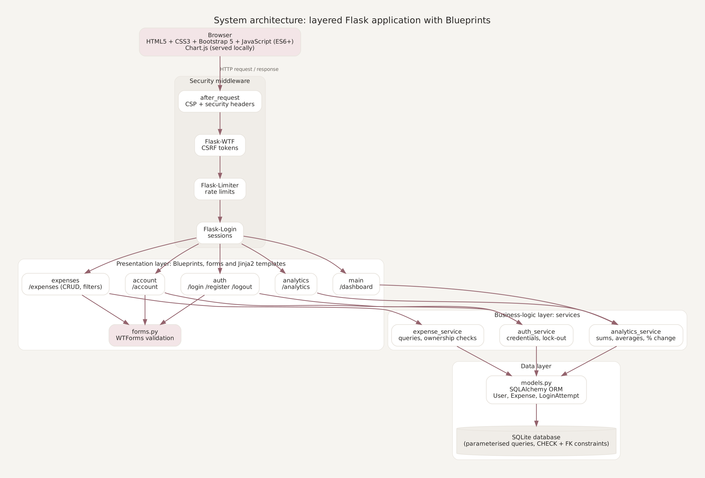

The application is split into presentation (Blueprints, forms, templates), business logic (`app/services`), and data (`models.py`, SQLite). Cross-cutting security middleware wraps every request. The factory `create_app()` builds the application for one of three configurations (development, testing, production).

## 13. Database Design

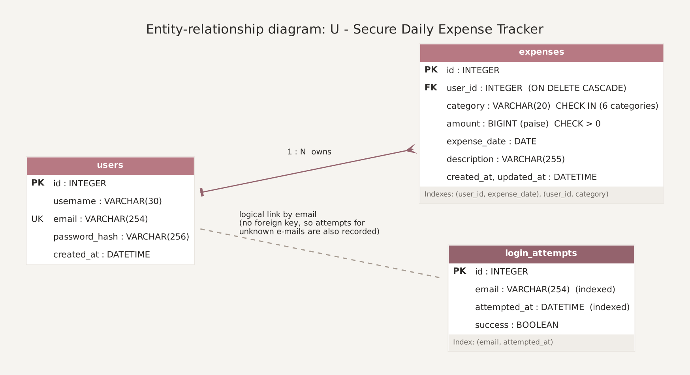

* **users** — identity and credential hash; `email` unique and indexed.
* **expenses** — one row per expense; `user_id` foreign key with `ON DELETE CASCADE`; `amount` stored as integer paise; `CHECK` constraints enforce positive amounts and the six allowed categories; composite indexes on `(user_id, expense_date)` and `(user_id, category)` support the dashboard and filter queries.
* **login_attempts** — append-only audit of sign-in attempts keyed by e-mail (indexed with time); no foreign key so attempts against unknown e-mails are also recorded.

Relationship: **one user — many expenses** (1:N). Strict isolation is achieved by always querying `WHERE user_id = :current_user`.

## 14. ER Diagram

See Section 13 (`diagrams/er_diagram.png`, source `er_diagram.dot`).

## 15. Use Case Diagram

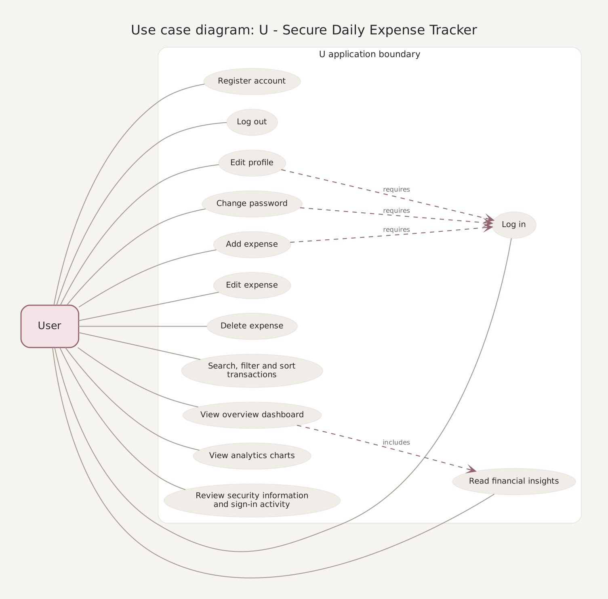

The single actor is the registered **User**. Registration and login are available to anonymous visitors; every other use case requires an authenticated session.

## 16. Data Flow Diagrams

**Level 0 (context):**

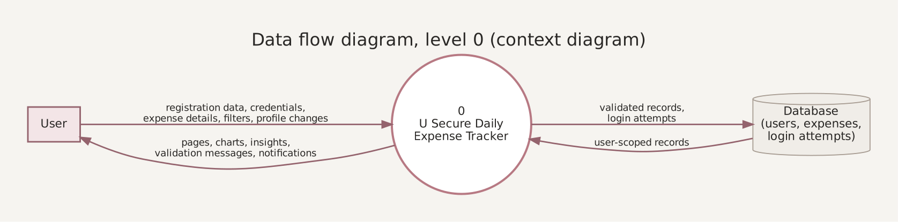

**Level 1:**

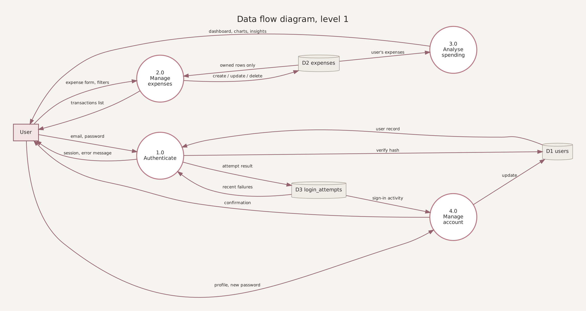

## 17. Module Descriptions

| Module | Files | Responsibility |
|---|---|---|
| Application factory | `app/__init__.py`, `config.py`, `extensions.py` | Configuration per environment, extensions, security headers, error pages, CLI `init-db` |
| Authentication | `blueprints/auth`, `services/auth_service.py` | Register, login, logout, lock-out, attempt log |
| Dashboard | `blueprints/main`, `services/analytics_service.py` | Overview figures and charts |
| Expenses | `blueprints/expenses`, `services/expense_service.py`, `forms.py` | CRUD, filtering, sorting, pagination, ownership checks |
| Analytics | `blueprints/analytics`, `services/analytics_service.py` | Trends, distribution, comparison, statistics, insights |
| Account | `blueprints/account` | Profile, password change, security information |
| Models | `models.py` | `User`, `Expense`, `LoginAttempt`, `Money` type |
| UI | `templates/`, `static/css/u.css`, `static/js/` | Design system, responsive layout, charts, interactions |

**Calculation rules (all transparent):** totals are sums; averages are total ÷ count; daily average is month-to-date total ÷ days elapsed; percentage change is (current − previous) ÷ previous × 100 and is *undefined* (not shown as a number) when the base is zero. Month-to-date spending is compared with the **same days** of the previous month so that early-month figures are not misleadingly low. No machine learning is used or claimed.

**Design system.** Strict palette: ivory #F6F4F0, white #FFFFFF, secondary #F0EDE8, charcoal #292725, grey #858079, dusty rose #B77983, light rose #F3E5E7, border #E9E5DF, taupe #A69B91, dark rose #94636D. Manrope for headings and DM Sans for body text. A test (`test_every_colour_in_our_own_code_is_warm_or_neutral`) computes the hue of every colour in the project's own CSS, JavaScript and templates and fails if any is a cool (blue/green/purple/cyan) hue, and a second test rejects default Bootstrap colour classes.

## 18. Security Implementation

| Risk | Control | Verified by |
|---|---|---|
| Password disclosure | Salted scrypt (production) / PBKDF2 (tests) hashing; no plaintext; dummy hash for unknown users | `test_password_is_hashed_never_plaintext`, `test_same_password_gets_different_salt` |
| SQL injection | ORM bound parameters; server validation; DB `CHECK`; escaped LIKE wildcards | `test_sql_injection_in_category_is_rejected_and_table_survives`, `..._description_and_search_is_inert`, `test_database_constraints_back_up_validation` |
| XSS | Autoescape; CSP without `unsafe-inline`; no inline scripts, styles or event handlers; `tojson` for chart data | `test_descriptions_are_escaped_everywhere` (4 payloads), `test_no_inline_scripts_or_styles_in_pages` |
| CSRF | `CSRFProtect` on all POST routes including delete and logout | 5 CSRF tests |
| IDOR / data leakage | Ownership-scoped queries; 404 for foreign ids | `test_idor_*`, `test_users_only_see_their_own_records` |
| Brute force | Flask-Limiter + per-e-mail lock-out + attempt log + generic message | `test_login_endpoint_is_rate_limited`, `test_account_locks_after_repeated_failures_...` |
| Session attacks | HttpOnly, SameSite=Lax, Secure in production, session reset on login, password-fingerprinted session id | `test_session_cookie_flags`, `test_change_password_signs_out_other_sessions` |
| Open redirect | Same-site relative `next` only | `test_login_next_parameter_only_allows_local_paths` |
| Information leakage | Generic error pages; logs without passwords/e-mails; `no-store` caching | `test_unhandled_error_shows_generic_page`, `test_logs_never_contain_...` |

## 19. Testing Methodology

1. **Unit/service tests** of every calculation with fixed dates and hand-computed expected values (e.g. current month 575.50, same-days previous month 500.00 ⇒ +15.1 %).
2. **Integration tests** through the Flask test client covering every route and every rejection path.
3. **Security tests** with attack payloads (SQLi, XSS, forged/absent CSRF tokens, cross-user access, open-redirect URLs).
4. **Design-system tests** guarding the colour and typography rules.
5. **Browser end-to-end run** in real headless Chromium: the full user journey on an empty database, console monitored for CSP violations and script errors, 390 px viewport checked for horizontal overflow.

Test isolation note: Flask-Login and Flask-WTF cache per-request state on `flask.g`; because the fixtures keep one application context open, the test configuration clears that cache before each request so tests behave like real, separate requests.

## 20. Test Cases and Results

Genuine output is stored in `TEST_RESULTS.txt` (pytest `-v`) and `BROWSER_CHECK_RESULTS.txt`.

**Result: 128 passed, 0 failed** (Python 3.12.3, Linux). **Browser run: 31 of 31 checks passed.**

Mapping of the required test areas to implemented tests:

| # | Required area | Test(s) | Result |
|---|---|---|---|
| 1 | Registration | `test_registration_creates_user_and_redirects_to_login`, `..._normalises_email_case`, `..._validates_input` | Pass |
| 2 | Duplicate e-mail | `test_duplicate_email_is_rejected` | Pass |
| 3 | Password hashing | `test_password_is_hashed_never_plaintext`, `test_same_password_gets_different_salt` | Pass |
| 4 | Successful login | `test_successful_login`, `test_login_is_case_insensitive_on_email` | Pass |
| 5 | Incorrect login | `test_wrong_password_gives_generic_message`, `test_unknown_email_gives_same_generic_message` | Pass |
| 6 | Failed login recording | `test_failed_and_successful_logins_are_recorded`, lock-out tests | Pass |
| 7 | Rate limiting | `test_login_endpoint_is_rate_limited`, `test_rate_limit_applies_only_to_post` | Pass |
| 8 | Dashboard protection | `test_protected_pages_redirect_anonymous_users`, `test_post_endpoints_require_login` | Pass |
| 9 | Add expense | `test_add_expense`, `test_amount_is_stored_exactly` | Pass |
| 10 | View expenses | `test_view_expenses_lists_only_formatted_records` | Pass |
| 11 | Edit expense | `test_edit_expense`, `test_edit_form_is_prefilled` | Pass |
| 12 | Delete expense | `test_delete_expense`, `test_delete_requires_post` | Pass |
| 13 | Invalid amount | `test_invalid_amounts_are_rejected` (13 inputs) | Pass |
| 14 | Invalid category (+ SQLi) | `test_invalid_categories_are_rejected` (5), `test_sql_injection_in_category_is_rejected_and_table_survives` | Pass |
| 15 | Invalid date | `test_invalid_dates_are_rejected` (6), `test_future_dates_are_rejected` | Pass |
| 16 | Category filtering | `test_category_filter`, `test_combined_filters` | Pass |
| 17 | Date filtering | `test_single_date_filter`, `test_date_range_filter`, `test_reversed_date_range_is_ignored` | Pass |
| 18 | Analytics calculations | 17 tests in `test_analytics.py` | Pass |
| 19 | User data isolation | `test_users_only_see_their_own_records`, `test_analytics_never_include_other_users` | Pass |
| 20 | IDOR prevention | `test_idor_edit_is_blocked`, `test_idor_delete_is_blocked`, `test_idor_unknown_ids_...` | Pass |
| 21 | CSRF protection | `test_forms_require_csrf_token`, `test_state_changing_actions_need_csrf`, `test_logout_needs_csrf_token`, `test_every_post_form_in_the_ui_carries_a_token` | Pass |
| 22 | XSS escaping | `test_descriptions_are_escaped_everywhere`, `test_xss_in_search_term_is_escaped` | Pass |
| 23 | Logout | `test_logout_ends_session`, `test_logout_rejects_get` | Pass |
| 24 | Access after logout | `test_logout_ends_session` (dashboard redirects) and browser check "dashboard blocked after logout" | Pass |

Additional suites cover pagination, sorting, wildcard-safe search, security headers, cookie flags, production configuration, safe error pages, log hygiene, static assets and the colour system.

## 21. Screenshots

Captured from the running application in headless Chromium. They show **sample records created only for these screenshots**; the shipped application contains no demo data.

| Login | Register |
|---|---|
| 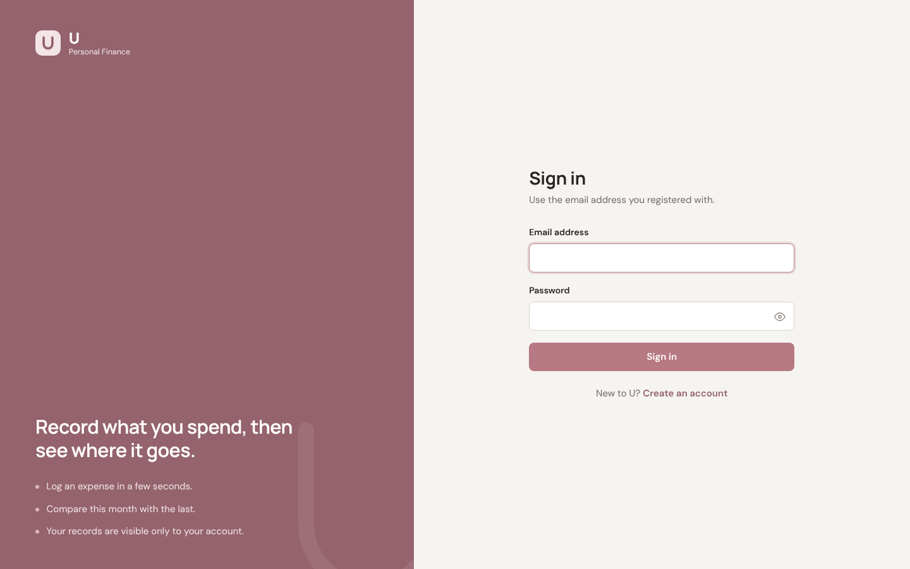 | 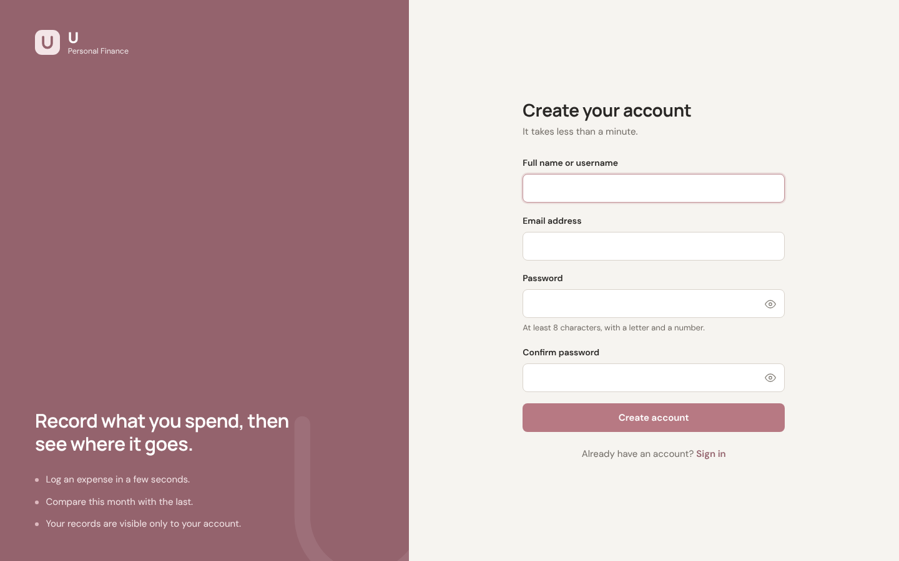 |

**Overview**

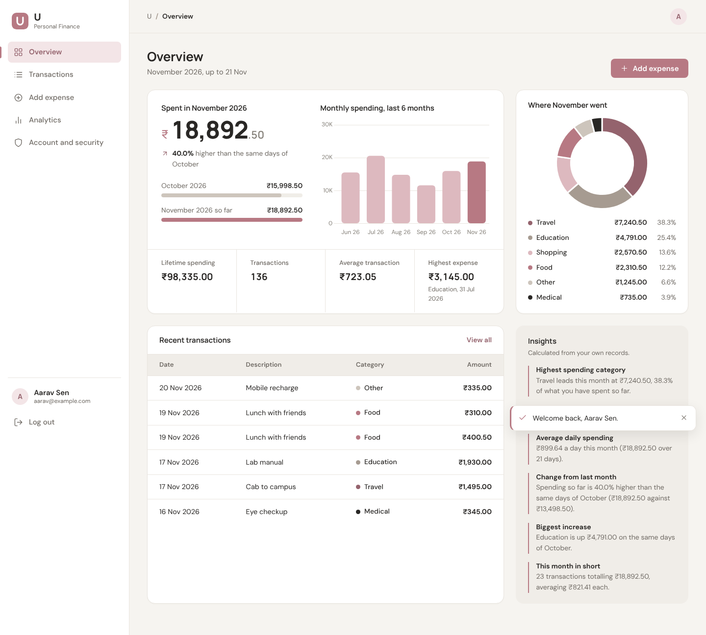

**Transactions**

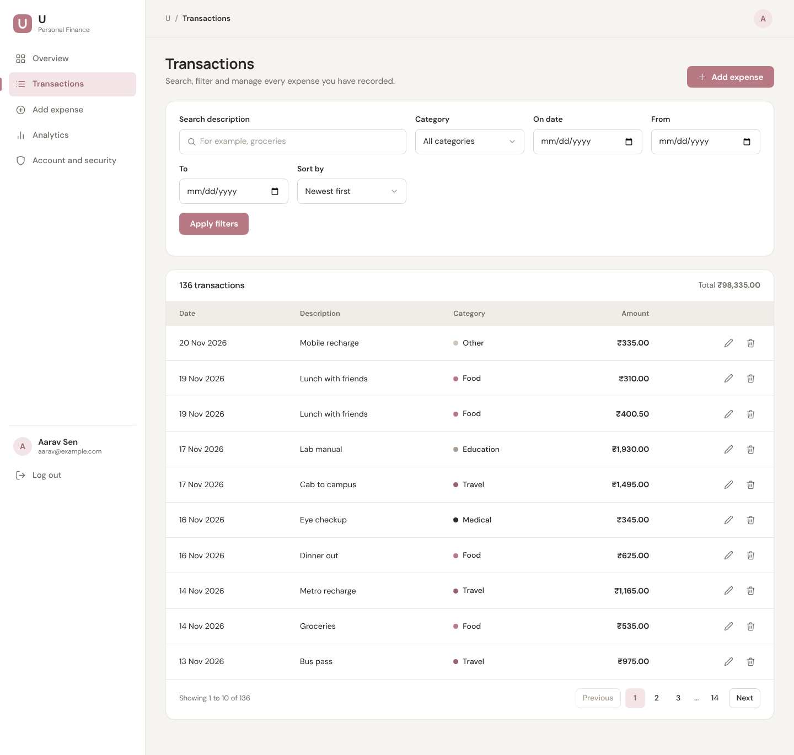

**Add expense / validation feedback**

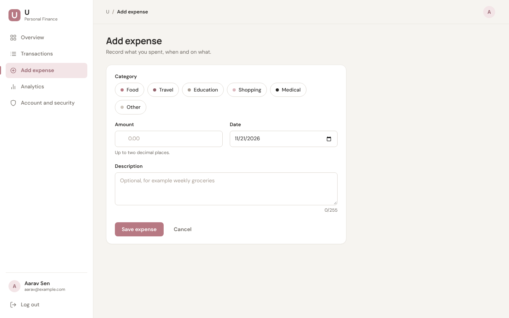 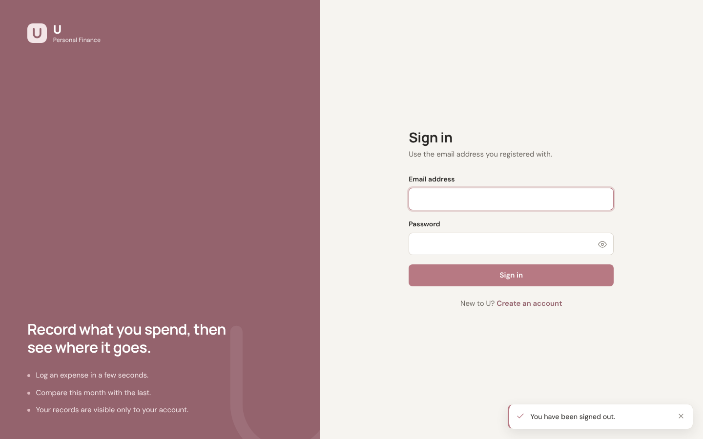

**Analytics**

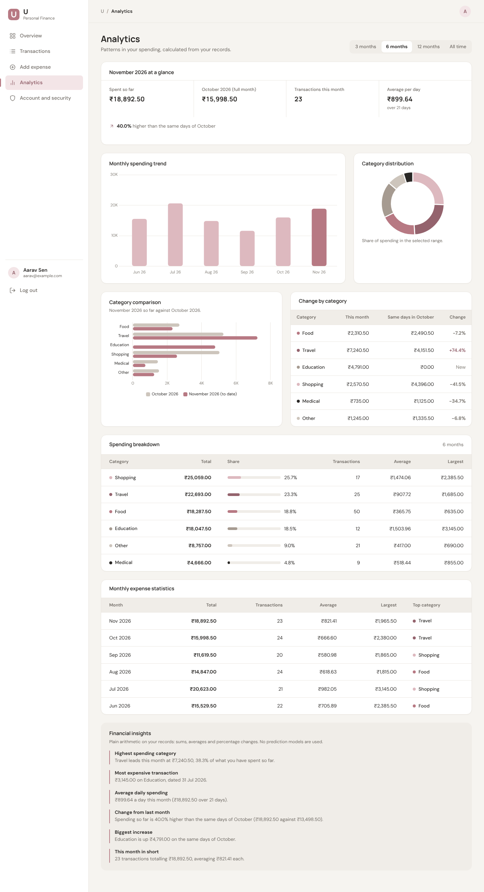

**Account and security**

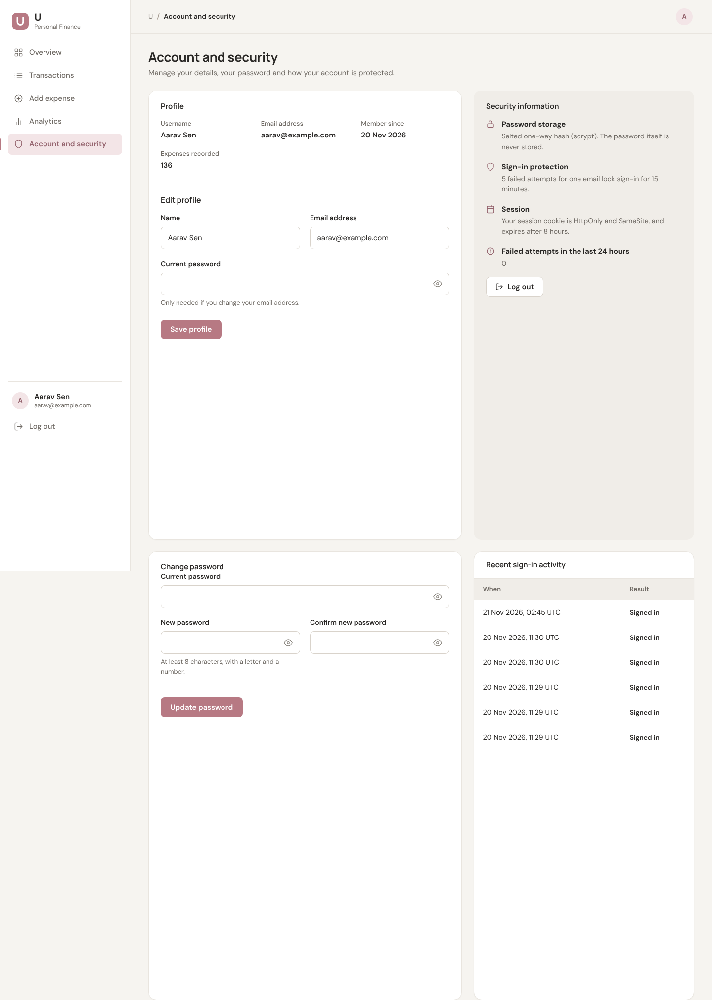

**Delete confirmation / filtered list**

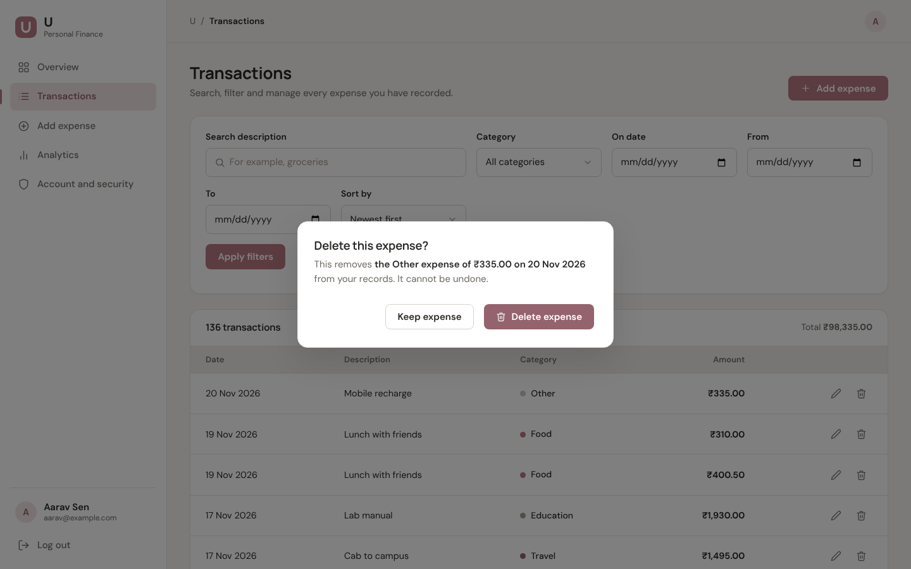 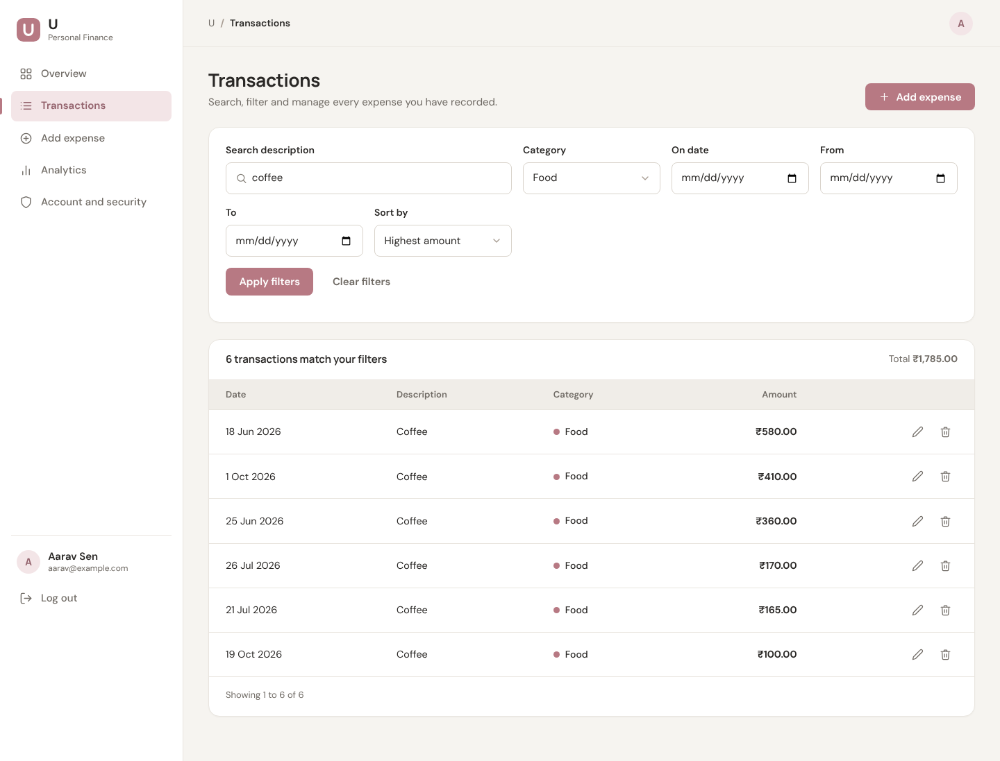

**Mobile (390 px)**

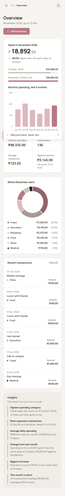 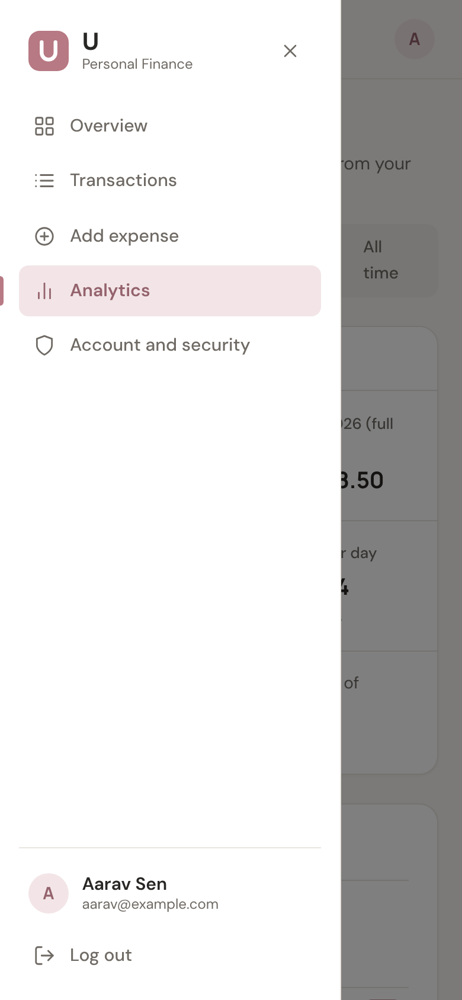

## 22. Limitations

* Validated on Linux with Python 3.12 and headless Chromium only; Windows instructions, Firefox, Safari and physical phones were not tested.
* No e-mail verification, password-reset flow, two-factor authentication or account deletion.
* Single currency; no budgets, recurring expenses, exports or receipts.
* SQLite is single-writer; the default rate-limit store is in-memory.
* Primary-button contrast (white on #B77983) is about 3.5:1, meeting WCAG AA only for large text; no formal accessibility audit was done.
* Security verification is automated only — no external penetration test or dependency-vulnerability scan.
* Dates use the server's local day.

## 23. Future Scope

Password reset and e-mail verification; TOTP two-factor authentication; budgets with alerts; recurring expenses; CSV/PDF export; receipt attachments; multi-currency support; PostgreSQL; REST API with token authentication; automated accessibility and dependency scanning in CI.

## 24. Conclusion

U demonstrates that a small Flask application can combine correct financial data handling, layered architecture, a deliberate visual identity and a security-first design. All required modules were implemented; 128 automated tests and a 31-step real-browser run passed; and the known limitations are documented rather than hidden. The project provides a base that can grow towards a production-grade personal finance service.

## 25. References

1. Flask documentation — https://flask.palletsprojects.com/
2. SQLAlchemy documentation — https://docs.sqlalchemy.org/
3. Flask-Login, Flask-WTF, Flask-Limiter and Flask-SQLAlchemy documentation (Read the Docs / project pages).
4. Werkzeug security helpers — https://werkzeug.palletsprojects.com/
5. OWASP Top 10 — https://owasp.org/www-project-top-ten/
6. OWASP Cheat Sheet Series (Password Storage, CSRF Prevention, SQL Injection Prevention, XSS Prevention, Content Security Policy) — https://cheatsheetseries.owasp.org/
7. NIST SP 800-63B, Digital Identity Guidelines: Authentication and Lifecycle Management — https://pages.nist.gov/800-63-3/sp800-63b.html
8. MDN Web Docs: Content-Security-Policy; Set-Cookie (HttpOnly, SameSite, Secure) — https://developer.mozilla.org/
9. RFC 6265, HTTP State Management Mechanism — https://datatracker.ietf.org/doc/html/rfc6265
10. Bootstrap 5.3 documentation — https://getbootstrap.com/docs/5.3/
11. Chart.js documentation — https://www.chartjs.org/docs/
12. pytest documentation — https://docs.pytest.org/

*These are the official documentation sources consulted for design decisions; no figures, quotations or statistics are reproduced from them.*
